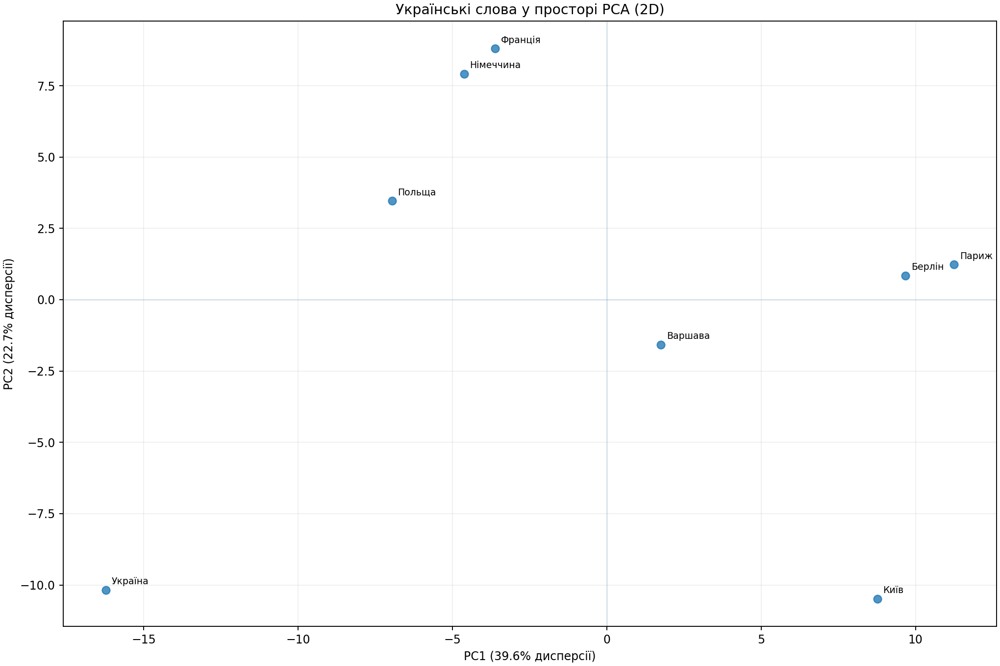
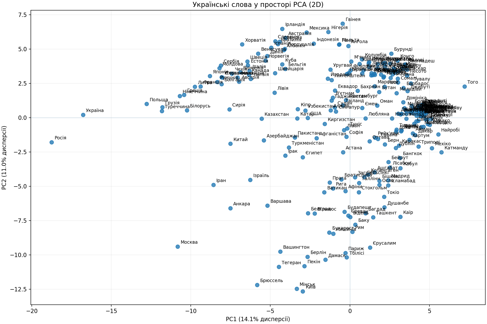

# Звіт з лабораторної роботи № 3

**Тема:** Дослідження векторних представлень слів української мови.

**Мета:** Дослідити Word2Vec, обчислити міри близькості, реалізувати
аналогії типу `країна1 - столиця1 + столиця2` та побудувати PCA-графіки.

## Хід виконання

1. Завантажено тестовий набір `country-capital` та модель Word2Vec (300 вимірів).
2. Реалізовано косинусну подібність і евклідову відстань.
3. Реалізовано пошук аналогій з виключенням слів із запиту.
4. Перевірено результати на 4271 прикладах.
5. Побудовано PCA-графіки обраних і всіх унікальних доступних слів.

## Кількісні результати

- Кількість тестів: **4271**
- Можливо обчислити (усі 4 слова є в моделі): **3935**
- Правильних відповідей: **587**
- Точність за всіма тестами: **0.1374 (13.74%)**
- Точність серед доступних тестів: **0.1492 (14.92%)**
- Частка доступних тестів (coverage): **92.13%**
- Пропущено через відсутні вхідні слова: 302
- Пропущено через відсутнє правильне слово: 34
- Пропущено через нульовий вектор: 0

## Приклади аналогій

| Столиця 1 | Країна 1 | Столиця 2 | Передбачена країна 2 | Косинусна схожість |
|---|---|---|---|---|
| Афіни | Греція | Київ | Україна | 0.6561 |
| Варшава | Польща | Берлін | Німеччина | 0.6833 |
| Берлін | Німеччина | Париж | Франція | 0.7946 |

## PCA-візуалізація

**Висновок.** У роботі реалізовано векторні операції та пошук семантичних
аналогій для українських слів. Визначено точність на тестовому наборі;
частина помилок може бути пов'язана з неповним словником, неоднозначністю
слів і тим, що близькість векторів не гарантує правильної географічної
відповіді. PCA дозволяє наочно розглянути структуру векторів у двох вимірах.

*Важливо:* PCA-зображення є проєкцією та не відтворює всіх відстаней з
300-вимірного простору. Оцінку `accuracy_all` обчислено за всіма прикладами,
включно з тими, де слова відсутні (вони зараховані як помилки).
